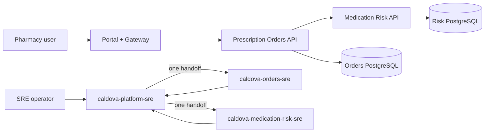

# Caldova Pharmacy A2A

Caldova Pharmacy is a prescription-fulfillment application organized around a shared platform team and two application teams. It demonstrates one-level Azure SRE Agent delegation without embedding failure hints, investigation playbooks, or fault controls in the service.

## Architecture



The application runs on Azure Container Apps. Orders and Medication Risk have internal ingress and separate PostgreSQL databases; the gateway is the only public service. Shared telemetry is stored in Log Analytics and Application Insights.

## Source

- [`app/`](app/) - TypeScript services and React portal
- [`infra/`](infra/) - subscription-scope Bicep
- [`../../sreagent-templates/recipes/caldova-platform-sre/`](../../sreagent-templates/recipes/caldova-platform-sre/) - platform agent recipe
- [`../../sreagent-templates/recipes/caldova-orders-sre/`](../../sreagent-templates/recipes/caldova-orders-sre/) - Orders agent recipe
- [`../../sreagent-templates/recipes/caldova-medication-risk-sre/`](../../sreagent-templates/recipes/caldova-medication-risk-sre/) - Medication Risk agent recipe

## Team boundaries

| Team | Application ownership | Agent |
|---|---|---|
| Platform | Gateway, Container Apps environment, networking, registry, shared telemetry | `caldova-platform-sre` |
| Prescription Orders | Orders API, fulfillment workflow, Orders PostgreSQL | `caldova-orders-sre` |
| Medication Risk | Safety API, medication-risk decisions, Risk PostgreSQL | `caldova-medication-risk-sre` |

The platform agent can call either application-team agent. Application-team agents do not call each other and return their findings to the platform agent for final synthesis.

## Deployment

Infrastructure uses a two-phase deployment:

1. Deploy resource groups, networking, registry, databases, identities, and monitoring with `deployApplications=false`.
2. Build the three images in ACR and redeploy with immutable image tags and `deployApplications=true`.

See [`infra/README.md`](infra/README.md) for parameters and commands. The service images use [`app/`](app/) as their Docker build context.

After all three agents are deployed, apply each generated recipe's extras. The Orders and Medication Risk recipes allow only the platform agent's managed identities and grant them the target-scoped A2A caller permissions; the platform recipe creates its two outgoing UAMI connections and verifies authenticated agent-card discovery.

## Validation

From [`app/`](app/):

```bash
npm ci
npm run lint
npm run typecheck
LOG_LEVEL=silent npm test -- --reporter=default
npm run build
```

The gateway, Orders API, and Medication Risk API expose `/health/live`, `/health/ready`, and `/health/dependencies`.
